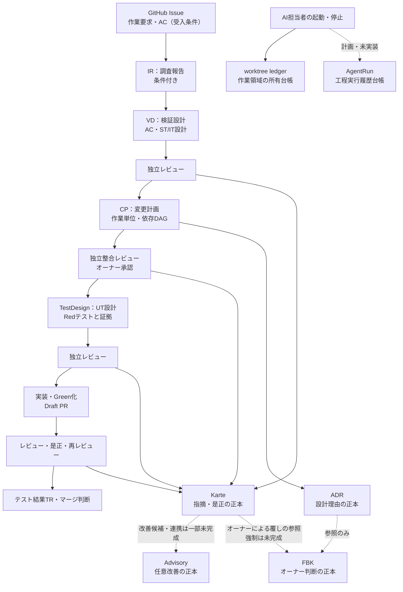
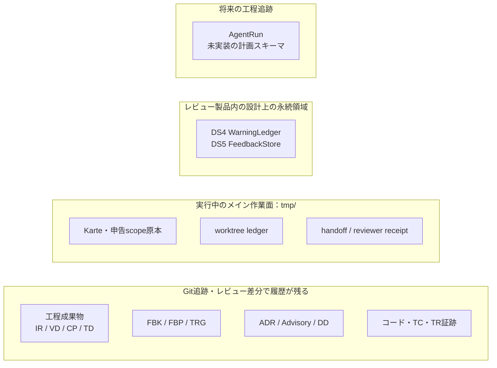

# review-system 台帳・Issue-pipeline成果物・スキーマ 統合調査レポート

**改訂:** 第2版（2026-11-14）  
**対象:** [hiratashinnya/review-system](https://github.com/hiratashinnya/review-system) の `main` ブランチ  
**確認したGitツリー:** `6d3141759cec072ee14f3b460a133f6966f56d44`（3,360追跡ファイル、再帰ツリーは未切り捨て）  
**調査方法:** 現行のSkill、役割契約、Pythonのスキーマ・検証・保存実装、README、Issue/PRを突合。**実機の `tmp/`、未マージの各作業ブランチ、CLI動作の再実行は未検査**。ファイル件数は原則 `main` の追跡ファイル数。

> 本書では、台帳（後から履歴・状態を追跡する記録）だけでなく、**Issue-pipeline（Issue処置の工程管理ワークフロー）の一次成果物**も扱う。両者を同一の台帳に統合する提案ではなく、**保存責任・参照関係・スキーマ・実装状態を一つの報告書で可視化する**ことが目的である。

## 0. 要点

1. **原本の責務は分かれている。** オーナー判断は `feedback_ledger`、設計理由は `ADR`、レビューの指摘と是正は `Karte`、任意改善は `Advisory`、工程成果物は `IR/VD/CP/TestDesign`、作業領域の占有は `worktree ledger` が正本。
2. **Issue-pipelineの4種の工程成果物には実装済みTOMLスキーマがある。** 調査報告（IR）、検証設計（VD）、変更計画（CP）、単体テスト設計（TestDesign）。共通の `issue_envelope` が、入力の版・参照・包含構造・実行依存・未解決事項を検証する。
3. **定義と運用実績を混同しない。** `main` 上ではFBKが56件、Harness ADRが1件、FBP/TRG/Advisoryが各0件。正式なIR/VD/CP/TestDesign TOMLも `main` では各0件。Karte・worktree台帳はローカル `tmp/` にありGitHubからは件数不明。
4. **工程実行の正本 `AgentRun` は計画段階。** 既存の成果物メタデータに `run_id` などはあるが、AI実行全体を追跡するdurableな実行台帳は別途実装が必要。
5. **設計とコードの差分に注意。** `review_system` 製品内部のDS5 FeedbackStoreは設計上の項目と現行の最小実装の項目が一致しない。スキーマ・保存が存在することと本番機能に結線されていることは別。

## 1. 全体像：3層に分ける



**実線:** 定義・実装で確認した記録関係。**破線:** 未完成の連携または参照のみであり、動作済みと断定しない関係。  
**用語:** DAG＝循環のない依存グラフ、Red/Green＝意図した失敗を先に作り実装後に通すテスト開発の状態、ST/IT/UT＝システム／結合／単体テスト。



## 2. 全アイテム一覧（正本・スキーマ・実績）

| アイテム（一般用語での説明） | 分類 | 正本／代表的な配置 | スキーマの状態 | `main`での観測 |
|---|---|---|---|---|
| **FBK / feedback_ledger**：オーナー方針・判断の原本 | 判断台帳 | `.ai/feedback/ledger/FBK-*.toml` | Python DocSpec／`feedback-ledger/v1.3`（既存の旧minorも許容） | **56件** |
| **FBP**：判断に基づく改善・改訂の提案管理票 | 提案台帳 | `.ai/feedback/queue/FBP-*.toml` | Python DocSpec／`feedback-proposal/v1` | **0件** |
| **TRG**：判断の週次棚卸し記録 | 点検台帳 | `.ai/feedback/triage/TRG-*.toml` | Python DocSpec／`feedback-triage/v1` | **0件** |
| **Advisory / ADV**：今すぐ直す必須欠陥ではない改善候補の中央記録 | 改善台帳 | `.ai/advisory/ledger/ADV-*.toml` | Pythonの固定フィールド集合／`advisory/v1` | **0件**（配置ディレクトリ自体未追跡） |
| **Harness ADR**：AI開発基盤の設計選択と理由 | 設計判断台帳 | `<tool>/adr/ADR-*.toml` | Python DocSpec／`harness-adr/v1.0` | **1件** |
| **IR / InvestigationReport**：現状・原因・影響範囲の調査 | 工程一次成果物 | `investigation_report/IR-<issue>.toml` | `issue-envelope/v1.0` | **0件** |
| **VD / VerificationDesign**：何をどう検証するかの設計 | 工程一次成果物 | `verification_design/VD-<issue>.toml` 等 | `issue-envelope/v1.0`＋包含木 | **0件** |
| **CP / ChangePlan**：解決方式・変更作業・依存関係の計画 | 工程一次成果物 | `change_plan/CP-<issue>.toml` 等 | `issue-envelope/v1.0`＋包含木・作業DAG | **0件** |
| **TestDesign / TD**：単体テスト設計とRed実行証拠の束 | 工程一次成果物 | `test_design/TD-<issue>.toml` | `issue-envelope/v1.0`＋red_evidence | **0件** |
| **ST/IT/UTのTD・TC・TR**：各レベルのテスト設計・ケース・結果 | テスト一次証跡 | `<tool>/verify/designs|reports|logs/`、`tests/<tool>/` | 個別文書・ソース形式、統一単一スキーマは未確認 | 現物あり（別節） |
| **ReviewReport / PlanReview**：独立レビュアーが提出する指摘報告 | レビュー入力成果物 | `tmp/_handoff/` 等。Karteへ取込み | `review-handoff/v1`＋finding書式、または独立レビューの同形式 | 一時成果物のため集計不可 |
| **Karte**：レビュー指摘・是正試行・再レビュー結果の正本 | 品質台帳 | `tmp/_karte/issue-<N>.md`、申告scope JSONL | Markdown構造とPython parser | **件数不明** |
| **worktree ledger**：AI作業領域の占有・回収・解放記録 | 実行資源台帳 | `tmp/_worktree/ledger.json` | JSON／`worktree-ledger/1` | **件数不明** |
| **AgentRun**：AI作業の実行状態・成果物受領・完了判定 | 将来の実行台帳 | 配置未確定 | Issue上の要求仕様のみ。実装済みschemaなし | **未実装** |
| **DD / Design Decision**：ドキュメントシステムや製品側の決定 | 設計記録 | `doc-system-v2/nodes/**/dd/**/*.yaml`、`docs/design/decisions.md` | JSON Schema形式の共通YAML sidecar（doc-system側）。Markdown側は別形式 | **33 YAML**（doc-system側） |
| **DS4 WarningLedger**：レビュー製品内で既出警告を抑制する記録 | 製品状態（設計） | `.review-state/warning-ledger.jsonl` | 設計書の1行JSON定義 | **0件**／専用実装未確認 |
| **DS5 FeedbackStore**：製品の個別指摘への人間の採否 | 製品状態（最小実装） | `.review-state/feedback.jsonl`（設計上） | 設計上の型と実装の3フィールドに差異あり | **0件**／append/readの最小実装あり |

**件数の注意:** `main` にファイルが無いことは「全ブランチ・ローカル環境にも無い」ことを意味しない。またテスト設計の実ファイル・コード・PRは、工程成果物TOMLの4種とは別々に管理される。

## 3. スキーマの読み方

- **必須**＝スキーマ／パーサで通常要求される欄。**任意**＝未設定を許す欄（実際の出力形式では空文字や空配列の明記を要求する場合がある）。
- **列挙**＝許可された文字列のみを受理。**参照**＝他の文書ID・Issue・ファイルパス等へのリンク。**SHA-256**＝ファイル内容から得る64桁の照合用ハッシュ。
- 次節はコードの**フィールドを網羅的に要約**したもので、コピーしてそのまま登録できる完全なTOMLではない。実際の作成には各CLIとcanonical serializerを使う。
- 「計画スキーマ」「設計スキーマ」は、コードが検証する実装済みスキーマと混同しない。

## 4. 台帳系の詳細スキーマ

### 4.1 FBK：オーナー判断の原本

**保存:** `.ai/feedback/ledger/FBK-YYYYMMDD-<slug>.toml`／**形式:** TOML。`schema` の現行例は `feedback-ledger/v1.3`。  
**一般的な役割:** 「誰が何を決めたか」「AI案と何が違ったか」「どのIssue・レビューから生じたか」の追跡。  
**定義:** [schema_ledger.py](https://github.com/hiratashinnya/review-system/blob/main/feedback_ledger/schema_ledger.py)、[schema_values.py](https://github.com/hiratashinnya/review-system/blob/main/feedback_ledger/schema_values.py)、[schema_version.py](https://github.com/hiratashinnya/review-system/blob/main/feedback_ledger/schema_version.py)。

| 構造 | フィールド（必須/任意） | 型・制約と意味 |
|---|---|---|
| トップ | `schema`, `id`, `topic`, `theme`, `occurred_at`, `decision_point`, `overridden_role`, `divergence`, `confidence_of_inference`, `recorded_by`, `affected_assets`：必須 | 版、識別子、表題、主題、判断日、判断局面、変更された担当の推奨、食い違いの分類、推測の確度、記録者、影響する既存パスの配列 |
| トップ | `supersedes`：任意 | 置換する古いFBKのID。元を直接上書きしない |
| `[[source]]`（1件以上） | `issue`：必須、`pr`, `round`, `finding_ids`：任意 | Issue番号、PR番号、レビューラウンド、個別指摘ID (`F-数字-数字`) |
| `[narrative]` | `background`, `recommendation`, `recommendation_reason`, `owner_verbatim`, `inferred_reason`：必須 | 背景、AIの推奨とその理由、**オーナーの逐語**、推測（`推測：`接頭辞が必要） |
| `[narrative]` | `uncertainty`：任意 | 未確定な点・暫定判断 |

**列挙:** `decision_point`＝`triage-order / scope-split / implementation / review-finding / disposition / merge / schedule / other / policy`。`divergence`＝`reversal / narrowing / widening / deferral / alternative-means / approval`。`confidence_of_inference`＝`low / medium / high`。`theme`＝`目的・評価 / 開発工程 / 実行体制 / 品質原則 / 検証・追跡 / AI判定 / 記録管理`。`overridden_role` は規定ロール名または `skill:<slug>`。旧版の一部では `theme` 等に互換規則がある。

**不変条件:** 既存のFBK本文のバイト変更・削除はmerge-base比較で拒否。修正は新IDを登録して`supersedes`で関連付ける。`status` は保存せず、提案や週次点検などの情報から導出する。逐語と推測を混在させない。

### 4.2 FBP：判断の変更提案

**保存:** `.ai/feedback/queue/FBP-YYYYMMDD-ascii-slug.toml`／**形式:** TOML／`feedback-proposal/v1`。  
**定義:** [schema_proposal.py](https://github.com/hiratashinnya/review-system/blob/main/feedback_ledger/schema_proposal.py)。

| 構造 | フィールド | 意味 |
|---|---|---|
| トップ・必須 | `schema`, `id`, `derived_from`, `target_assets`, `target_kind`, `routing`, `status`, `proposed_at` | 版、ID、根拠FBKのID配列、対象パス配列、変更対象区分、Issueか文書ノードかの行き先、進捗状態、提案日 |
| トップ・任意 | `decided_in`, `decided_by`, `decided_at`, `decision_reason`, `issue_ref`, `applied_pr` | 決着したTRG、判断者・日時・理由、起票先Issue、反映PR番号 |
| `[body]`・必須 | `problem`, `proposed_change`, `rationale` | 問題・提案変更・その根拠 |

**列挙:** `target_kind`＝`contract / criteria / governance / tooling`、`routing`＝`issue / node`、`status`＝`pending / approved / rejected / applied / superseded`。  
**遷移:** 代表経路は `pending→approved→applied`、`pending→rejected`、各状態から`superseded`。承認・却下・適用時に必要な根拠欄を検査する。

### 4.3 TRG：週次棚卸し記録

**保存:** `.ai/feedback/triage/TRG-YYYY-Www.toml`／**形式:** TOML／`feedback-triage/v1`。  
**定義:** [schema_triage.py](https://github.com/hiratashinnya/review-system/blob/main/feedback_ledger/schema_triage.py)。

| 構造 | フィールド | 意味 |
|---|---|---|
| トップ・必須 | `schema`, `id`, `period_start`, `period_end` | 版、ISO週に対応したID、週の開始日・終了日 |
| トップ・任意 | `reviewed` | 棚卸し対象のFBK ID配列 |
| `[[outcomes]]`（0件以上） | `entry`, `verdict`：必須、`proposal`, `merged_into`, `reason`：任意 | 対象FBK、結論、作成したFBP、統合先FBK、理由 |
| `[summary]` | `notes`：任意 | 週次まとめ |

**列挙:** `verdict`＝`proposed / no-change / merged-into / need-more-evidence`。対象集合の一致、ISO週の整合、参照先実在を検査。週内の追記・更新は許す（FBK本文の不変性とは異なる）。

### 4.4 Advisory / ADV：改善候補の中央台帳

**保存:** `.ai/advisory/ledger/ADV-YYYYMMDD-<topic-slug>.toml`／**形式:** TOML／`advisory/v1`。  
**定義:** [record_fields.py](https://github.com/hiratashinnya/review-system/blob/main/advisory/record_fields.py)、[records.py](https://github.com/hiratashinnya/review-system/blob/main/advisory/records.py)、[audit.py](https://github.com/hiratashinnya/review-system/blob/main/advisory/audit.py)、[README](https://github.com/hiratashinnya/review-system/blob/main/advisory/README.md)。

**トップレベルの固定16フィールド（未知キー拒否）:**

| フィールド | 型・意味 |
|---|---|
| `schema_version`, `id`, `topic`, `created_on` | 固定版`advisory/v1`、日付＋題名から決まる不変ID、1～30文字の題名、作成日 |
| `status` | `open / triaged / promoted / closed`（未仕分け・仕分け済み・Issue化済み・終了） |
| `sources` | **非空**の出典配列。`issue:782`、`pr:123`、`finding:F-782-1`など |
| `evidence`, `recommendation`, `triage_rationale`, `policy_version` | 根拠、推奨、仕分け理由、適用ポリシー版（例`1.0`）。各非空 |
| `related_ids`, `duplicate_reason` | 関連ADV ID配列、似た題名でも別件として扱う理由（文字列） |
| `promoted_issue` | 既存Issueへの紐付け（`owner/repo#123`形式）。昇格時は必須。**新規Issueを作成しない** |
| `base_sha256` | 競合更新を避ける元ファイルのSHA-256（または初期空文字） |
| `revision` | 整数。履歴イベント数と一致 |
| `history` | **非空**の監査イベント配列。以下の10フィールドを持つ |

**`history`イベントの固定10フィールド:** `action`, `from_status`, `to_status`, `actor`, `at`, `reason`, `policy_version`, `previous`, `payload_digest`, `digest`。  
`action`＝`create / amend / transition / promote`、`actor`は`main-thread`。UTC時刻・前イベントのダイジェスト・内容のダイジェストで鎖状に結び、更新競合を検出する。ただし暗号的な本人署名ではない。  
**段階:** `open→triaged→promoted→closed` を中心に、一部の差戻し・閉鎖が許可される。Karteからの自動仕分けはまだ完成していない。

### 4.5 Harness ADR：共通開発基盤の設計判断記録

**保存:** `<tool>/adr/ADR-YYYYMMDD-<slug>.toml`／**形式:** TOML／`harness-adr/v1.0`。  
**定義:** [adr/schema.py](https://github.com/hiratashinnya/review-system/blob/main/adr/schema.py)、[adr/README.md](https://github.com/hiratashinnya/review-system/blob/main/adr/README.md)。

| 構造 | フィールド | 意味 |
|---|---|---|
| トップ・必須 | `schema`, `id`, `topic`, `decided_at`, `phase`, `recorded_by`, `affected_assets` | 版、ID、主題、判断日、工程、記録者、対象パス |
| トップ・任意 | `supersedes`, `owner_decision_refs` | 置き換え元ADR、参照先FBK ID配列（オーナーの逐語は複製しない） |
| `[[source]]`（1件以上） | `issue`必須、`pr`任意 | 出典Issue・PR |
| `[context]` | `problem`必須、`constraints`任意 | 問題と制約 |
| `[decision]` | `chosen`, `rationale`, `tracking_status`必須、`tracking_issue`, `no_tracking_reason`任意 | 採用案、理由、フォローIssueの扱い |
| `[[alternatives]]`（1件以上） | `option`, `rejection_reason`必須 | 他案と不採用理由 |
| `[consequences]` | `positive`, `negative`, `followups`任意 | 利点・欠点・次の作業 |

**`tracking_status`:** `pending / filed / not_needed`。`filed`ならIssue番号が必要、`not_needed`なら不要理由が必要。設計内容の訂正は新規ADR＋`supersedes`、ただし追跡Issue番号の書戻しは例外として許す。

## 5. Issue-pipelineの工程成果物スキーマ

**重要:** 次の4型はすべて[`issue_envelope/schema.py`](https://github.com/hiratashinnya/review-system/blob/main/issue_envelope/schema.py)が定義し、[`issue_envelope/check.py`](https://github.com/hiratashinnya/review-system/blob/main/issue_envelope/check.py)が参照・構造・履歴条件等を検査する。仕様全文は[`issue_envelope/README.md`](https://github.com/hiratashinnya/review-system/blob/main/issue_envelope/README.md)。

### 5.1 共通エンベロープ（IR・VD・CP・TestDesignの全型）

**実装済み共通フィールド:**

| 属性 | 必須／任意 | 型と役割 |
|---|---|---|
| `schema` | 必須 | 固定文字列 `issue-envelope/v1.0` |
| `schema_version` | 必須 | 整数 |
| `id` | 必須 | `IR-<Issue>` / `VD-<Issue>` / `CP-<Issue>` / `TD-<Issue>`（中間・葉は接尾辞あり） |
| `producer` | 必須 | 調査者・設計者・テスト担当などの著作者ロール |
| `phase` | 必須 | `investigation / verification_design / solution_planning / test_design` の該当工程 |
| `artifact_type` | 必須 | `InvestigationReport / VerificationDesign / ChangePlan / TestDesign` |
| `issue` | 必須 | 対象Issue番号（整数） |
| `run_id` | 必須 | 実行を識別するID |
| `target_key` | 必須 | 処置対象や工程単位を束縛するキー |
| `input_refs` | 任意 | 入力成果物IDの配列。工程によって別の依存契約が必須化する |
| `input_digest` | 必須 | 入力成果物群の照合値 |
| `snapshot_oid` | 必須 | **成果物を作る前の入力ソース**のGitコミットOID（自身のcommitを自己参照しない） |
| `status` | 必須 | `ready / stop`（未完・停止を後工程で通さない） |
| `verification` | 任意 | 検証内容の文字列配列 |
| `unresolved_findings` | 任意 | 未解決指摘のID配列 |
| `owner_decisions` | 任意 | FBKなど既存判断台帳への参照配列 |
| `unresolved_owner_decisions` | 任意 | 未決のオーナー判断ID・要請 |
| `next_expected_artifact` | 任意 | 次工程に期待する成果物種別 |
| `stop_reason` | 任意 | STOP理由・前提不足 |

**入力束縛:** 呼び出し元が`producer / phase / issue / run_id / target_key / input_digest / snapshot_oid / artifact_type / input_refs`を期待値として与え、成果物の自己申告値と突合する。CPではAC参照も確認。入力が古い、未解決指摘や判断が残る、参照が欠ける場合は次へ進めない。これは工程履歴の照合であり、**AgentRun実行台帳そのものではない**。

### 5.2 IR / InvestigationReport（調査報告書）

**著作者:** `issue-investigator`／**工程:** `investigation`／**配置:** `investigation_report/IR-<issue>.toml`。  
**固有の必須フィールド（すべて長文テキスト）:** `facts`, `evidence`, `current_behavior`, `root_cause_or_unknown`, `affected_surfaces`, `constraints`, `open_questions`。  
**固有の任意フィールド:** `investigation_required`（整数、調査の要否記録）、`investigation_reason`（起動・省略理由）。  
原因・再現・影響・既決判断が明らかでない場合に調査する。調査自体を省略する場合も、起動判定と理由を永続成果物に残す契約。  
**根拠:** [issue-investigator共通契約](https://github.com/hiratashinnya/review-system/blob/main/.ai/agents/issue-investigator.md)。

### 5.3 VD / VerificationDesign（検証設計書）

**著作者:** `ac-designer`／**工程:** `verification_design`／**配置:** ルート `verification_design/VD-<issue>.toml`、中間 `verification_design/VD-<issue>-<slug>.toml`、葉 `<target>/verification_design/VD-<issue>.toml`。

**固有フィールド:** `st_td`, `st_tc`, `it_td`, `it_tc`（いずれも任意宣言の文字列配列。ただしACの網羅や工程契約が必要な要素を要求する）。  
**VD・CPに共通する包含木フィールド:** `scope`（必須、対象パス配列）、`parent`（任意、親ID）、`children`（任意、子ID配列）、`depends_on`（任意、ノード間依存ID配列）。  
**構造制約:** 単一対象でもルートと対象の葉を分ける。ルート・中間はリポジトリ直下の専用ディレクトリ、葉は実際の対象ディレクトリ配下に置く。親のscopeは子を包含し、循環依存や孤立した構造を検査する。  
**意味:** 何をもって完了とするか（ST・ITの受入条件／テストケース）を**実装方式より先に**定義する。独立の`plan-reviewer`が単独レビューを行う。  
**根拠:** [ac-designer](https://github.com/hiratashinnya/review-system/blob/main/.ai/agents/ac-designer.md)、[placement.py](https://github.com/hiratashinnya/review-system/blob/main/issue_envelope/placement.py)。

### 5.4 CP / ChangePlan（変更計画書）

**著作者:** `change-planner`／**工程:** `solution_planning`／**配置:** ルート `change_plan/CP-<issue>.toml`、中間 `change_plan/CP-<issue>-<slug>.toml`、葉 `<target>/change_plan/CP-<issue>.toml`。

**固有の必須フィールド（長文テキスト）:** `selected_solution`, `interfaces`, `invariants`, `failure_behavior`, `oos`, `operational_verification`。  
**固有の任意フィールド:** `adr_refs`（ADR ID参照の配列）。`scope / parent / children / depends_on` はVDと共通。  
**繰返しテーブル `[[work_units]]`（**1件以上**）:**

| キー | 必須／任意 | 意味 |
|---|---|---|
| `id` | 必須 | 小さく独立に検証できる作業単位ID |
| `scope` | 必須 | 作業対象パス配列 |
| `ac_refs` | 必須 | 対応する受入条件の参照配列 |
| `depends_on` | 任意 | **作業単位**間の実行依存ID。包含木の`depends_on`とは別DAG |

**実装上の着眼点:** CP内では「どの変更がどの変更の子か」と「どの作業を先に終えるか」は別の構造。代替案・決定理由はADRが正本。オーナー逐語はFBKが正本。CPには照合用の参照を持たせる。  
**根拠:** [change-planner](https://github.com/hiratashinnya/review-system/blob/main/.ai/agents/change-planner.md)。

### 5.5 TestDesign / TD（単体テスト設計とRed証拠）

**著作者:** `test-writer`／**工程:** `test_design`／**配置:** `test_design/TD-<issue>.toml`。

| 構造 | キー | 意味 |
|---|---|---|
| トップ・必須 | `work_unit` | CPで承認済みの**単一**作業単位ID |
| トップ・必須 | `ut_td`, `ut_tc` | 単体テスト設計書・テストコードの**実在ファイルパス配列**（単なる識別子ではない） |
| `[[red_evidence]]`（**1件以上**） | `tc`, `tc_sha256`, `log`, `log_sha256`, `command`, `exit_code`, `failure_reason`（全て必須） | テストコードのパス・ハッシュ、失敗ログのパス・ハッシュ、実行コマンド、正の非ゼロ終了コード、失敗理由 |

**列挙:** `failure_reason` は `implementation_missing` のみ。syntax/import/環境エラーはRed成功とみなさない。  
**追加制約:** TD・TC・ログのパスはリポジトリ内の実在する通常ファイル。HEADにコミットされ、チェックアウト上の内容とHEAD blobが一致する必要がある。`input_refs`は承認済みCPのID、`input_digest`はCPのコミット済みbytesのSHA-256。レビューを通過した同一work unitのTestDesignを実装担当が受け取り、テストをGreen化する。  
**根拠:** [test-writer](https://github.com/hiratashinnya/review-system/blob/main/.ai/agents/test-writer.md)、[issue_envelope/red_evidence.py](https://github.com/hiratashinnya/review-system/blob/main/issue_envelope/red_evidence.py)。

### 5.6 ReviewReport / PlanReview（独立レビュー結果の受渡し）

**性質:** 永続TOML4型とは別の成果物。`PlanReview`（設計レビュー）は**commitされる新しいエンベロープとしては保存しない**。各レビューのfinding（指摘）を同一IssueのKarteに取り込む。  
**レビューの受渡しメタデータ `review-handoff/v1`:** [`karte/review_envelope.py`](https://github.com/hiratashinnya/review-system/blob/main/karte/review_envelope.py)。

| キー | 型・制約 |
|---|---|
| `schema` | 固定 `review-handoff/v1` |
| `schema_version` | 固定整数`1` |
| `producer` | 固定`pr-reviewer` |
| `artifact_type` | 固定`ReviewReport` |
| `phase` | `test_design / implementation` |
| `issue` | 正の整数 |
| `run_id`, `target_key` | ヘッダに往復可能な安全な文字集合で128字以内 |
| `input_digest` | SHA-256、64桁 |
| `snapshot_oid` | Gitの40桁OID |
| `status` | 固定`ready` |
| `next_expected_artifact` | 空文字 |

**指摘1件の入力スキーマ:** `harm`, `harm_detail`, `severity`, `scope`, `summary`, `evidence`, `expected`, `recheck` が必須、`locus` は任意。`status`（既定open）、`distinct_from`、`disposition`等は任意。見出しは`### new`または`### F-<issue>-<seq>`。`finding`の永続形は次のKarte節。  
**保存・取り込み:** `tmp/_handoff/pr-reviewer--<key>.md`等で受け渡し、`karte ingest-reviewer`が期待値と照合後、IssueのKarteへ格納。レビューアの申告scope原本は別JSONL。  
**根拠:** [plan-reviewer](https://github.com/hiratashinnya/review-system/blob/main/.ai/agents/plan-reviewer.md)、[review_report.py](https://github.com/hiratashinnya/review-system/blob/main/karte/review_report.py)、[Issue-pipeline共通手順](https://github.com/hiratashinnya/review-system/blob/main/.ai/skills/issue-pipeline/SKILL.md)。

### 5.7 実装・テスト・運用検証の成果物

- **実装コード・Draft PR:** Git差分とGitHub PRが本体。`issue-implementer`は `tmp/_handoff/issue-implementer--issue-<N>....yaml` に実行結果を返す。
- **実装ハンドオフYAMLのキー:** `schema_version`, `agent`, `status`, `issue`, `branch`, `pr_url`, `changed_files[]`, `cross_cutting_checks[]`, `tests{command,result,summary}`, `out_of_scope_findings[]`, `stop_reason`。`cross_cutting_checks`の要素は`problem_type / loci / treatment`、`out_of_scope_findings`にはレビューfindingと同じ実害・根拠などを入れる。**これは工程の受渡し報告であり、FBKやAgentRunの代用品ではない。** 出典：[issue-implementer](https://github.com/hiratashinnya/review-system/blob/main/.ai/agents/issue-implementer.md)。
- **テスト本体・証跡:** ST/IT/UTそれぞれの`TD`（テスト設計）→`TC`（テストケース）→`TR`（テスト実施結果）を結合する。推奨配置は`<tool>/verify/designs|reports|logs`および`tests/<tool>/`。**全形式を束ねる単一の登録スキーマは確認できなかった**。個別Markdown、テストコード、ログの形式・ルールが適用される。
- **3a／3b:** オーナーによるマージ後のST-TR/IT-TR/UT-TRを各TD/TCに関連付ける。継続観測は常設監視へ、単発の実機確認は別の検証Issue候補へ分離する。出典：[Issue-pipeline共通手順](https://github.com/hiratashinnya/review-system/blob/main/.ai/skills/issue-pipeline/SKILL.md)。
- **mainで確認した既存テスト証跡の例:** `issue_envelope/verify/designs/IT-TD-371-envelope.md`、`issue_envelope/verify/reports/IT-TR-371-envelope.md`、`issue_envelope/verify/reports/AC-EVIDENCE-371.md`。これは工程管理機構の開発・検証証跡であり、**正式なCP/VD等のTOMLレコードが存在することの証明ではない**。

## 6. 実行時の品質・資源台帳の詳細スキーマ

### 6.1 Karte：指摘・試行・結果（ローカルMarkdown正本）

**保存:** メインworktreeの`tmp/_karte/issue-<N>.md`。  
**構造:** `# Karte: issue-<N>`を先頭とし、個別finding・Attempt・ResultをMarkdownブロックで記録。定義は[`karte/finding_record.py`](https://github.com/hiratashinnya/review-system/blob/main/karte/finding_record.py)、[`karte/block_records.py`](https://github.com/hiratashinnya/review-system/blob/main/karte/block_records.py)、[`karte/vocabulary.py`](https://github.com/hiratashinnya/review-system/blob/main/karte/vocabulary.py)。

**Finding（レビュー指摘）の全フィールド:**

| 項目 | 型と意味 |
|---|---|
| `id` | `F-<issue>-<連番>` |
| `status` | `open / resolved` |
| `harm`, `harm_detail` | `real / none`（実害有無）、放置したとき何が起きるか |
| `severity` | `blocker / major / minor` |
| `locus` | 対象ファイル・場所の配列。複数箇所も1指摘で保持可 |
| `summary`, `evidence`, `expected`, `recheck` | 指摘概要、実証根拠、期待状態、再確認手順 |
| `scope` | `in / out`（レビューアの申告、オーナーのみ上書き可能） |
| `disposition`, `deferred_to`, `waived_by`, `waived_reason` | オーナーが決める対処方針。`fix-here / deferred / waived`または未決。申し送り先・免除者・理由 |
| `rounds`, `resolved_round` | 指摘が登場したレビューラウンドの整数配列、解決ラウンド（任意） |

**Attempt（是正試行）の全フィールド:** `number`, `round`, `finding_ids`, `root_cause`, `change_kind`, `targets`, `diagnosis`。  
`change_kind`＝`logic / data-structure / interface / config / test / doc / revert`。根本原因と実施対象を記録。  
**Result（是正の実測結果）の全フィールド:** `attempt`, `finding_ids`, `touched`, `outcome`, `note`。`outcome`＝`fixed / partial / no-change / regressed`。

**verdict（通過判定）:** 指摘の有無だけでなく、未解消の実害とオーナーのdispositionを踏まえて導出する。実害ありで`deferred`/`waived`となった項目は履歴に残しつつ、所定の条件で通過阻害から除外する。`harm:none`を一律自動免除しない。  
**保護境界:**レビューアの指摘原本、主文脈の転記、オーナーの処置決定は別権限で扱う。

### 6.2 Karte：申告scope原本と進行ポインタ（JSONL/JSON）

**申告scope原本:** `tmp/_karte/issue-<N>.declared-scope.jsonl`。1行1JSONで、キーは次のとおり。

```json
{"round": 1, "id": "F-123-01", "scope": "in"}
{"round": 1, "id": "F-123-01", "scope": "out", "by": "owner"}
```

`round`は整数、`id`は文字列、`scope`は`in/out`、`by`は省略または`owner`。上の値は**型を示す架空の例**であり、特定の指摘の実在を意味しない。  
**進行ポインタ:** `tmp/_karte/active.json`＝`{issue: integer, round: integer, review_expect?: object}`。`review_expect`がある場合は上記`review-handoff/v1`の束縛キー（`producer`, `phase`, `issue`, `run_id`, `target_key`, `input_digest`, `snapshot_oid`, `artifact_type`）を持つ。取り込みが成功すると期待値は消える。  
**根拠:** [scope_record_parser.py](https://github.com/hiratashinnya/review-system/blob/main/karte/scope_record_parser.py)、[active_pointer.py](https://github.com/hiratashinnya/review-system/blob/main/karte/active_pointer.py)、[review_expectation.py](https://github.com/hiratashinnya/review-system/blob/main/karte/review_expectation.py)。

### 6.3 worktree ledger：作業領域の所有・解放記録（JSON）

**保存:** メインworktreeの`tmp/_worktree/ledger.json`。**schema_version:** `worktree-ledger/1`。  
**根拠:** [issue_start/worktree_ledger.py](https://github.com/hiratashinnya/review-system/blob/main/issue_start/worktree_ledger.py)。

```json
{
  "schema_version": "worktree-ledger/1",
  "entries": [
    {
      "entry_id": "wl-abcdef123456",
      "issue": 123,
      "agent_type": "issue-implementer",
      "round": null,
      "branch_name": null,
      "handoff_path": null,
      "dispatched_at": "<UTC時刻>",
      "agent_id": null,
      "worktree_path": null,
      "status": "open",
      "collected_to": null,
      "closed_at": null,
      "notes": []
    }
  ]
}
```

*上記はフィールド構造を説明する合成例であり、実レコードではない。*

| フィールド | 意味 |
|---|---|
| `entry_id`, `issue`, `agent_type` | 所有台帳の行ID、対象Issue、担当エージェントの種類 |
| `round`, `branch_name`, `handoff_path` | レビューラウンド、ブランチ、受渡しファイル（必要に応じてnull） |
| `dispatched_at` | 起動受付の時刻（診断用） |
| `agent_id`, `worktree_path` | 実際の担当インスタンスID、占有作業領域の相対パス（束縛前はnull） |
| `status` | `open / running / stopped / collected / release_pending / released / stale / abandoned` |
| `collected_to`, `closed_at` | 回収先、解放・廃棄等の記録時刻 |
| `notes` | 追記される`{at, note}`配列 |

**状態遷移:** 起動受理`open`→実行中`running`→停止確認`stopped`→証拠回収`collected`→解放`released`。異常は`stale`、物理削除待ちは`release_pending`、明示廃棄は`abandoned`。台帳自身はworktreeを削除しない。時刻をTTLとして勝手に`stale`扱いせず、状態と実在を照合する。

### 6.4 AgentRun：計画されている工程実行台帳（**未実装・スキーマ案段階**）

**出典:** [Issue #409「AgentRun ledgerとclose gateでサブエージェント実行ライフサイクルを機械管理する」](https://github.com/hiratashinnya/review-system/issues/409)（目的：AI担当者の待機・通知遅延・実行完了を機械的に追跡して、不要な人手確認と誤クローズを防ぐ）。

**要求されているフィールド群（これはJSON/TOMLの確定キー宣言ではない）:**

| 分類 | 要求項目 |
|---|---|
| 同一性 | run ID、`agent_id`、`target_key`、`scope`、phase、親Issueと実行Issue、冪等キー |
| 依存 | 他runの完了依存、CPのwork unitの依存、前段成果物のdigestとsnapshot OID |
| 期待成果 | expected outputs、handoff、期待成果物ID/参照 |
| 実行観測 | 状態、heartbeat／last_activity、next_check_at、checkpoint |
| 品質と判断 | 検証コマンドと結果、unresolved finding、owner decision、レビュー結果の受理状態 |
| 監査 | 更新履歴・再起動後復元・並行closeの安全性 |

**要求状態:** `queued / running / waiting / completed / failed / stalled`。単なるwait timeoutを失敗としない。完了通知だけで`completed`へ遷移せず、handoff・成果物・検証結果・依存完了・未解決指摘の条件を照合する。  
**正本の境界:** AgentRun＝実行ライフサイクル、worktree ledger＝物理作業面の所有、Karte＝レビュー指摘と是正。**統合台帳を増やすのではなく、相互参照で二重正本を避ける。**

## 7. 製品／ドキュメント固有の記録スキーマ

### 7.1 DD：doc-system-v2の設計判断ノード（YAML）

**配置:** `doc-system-v2/nodes/04-verification/dd/decided/<slug>.yaml`（別ステータスなら`closed/`等）。  
**正規スキーマ:** [doc-system-v2/schema/sidecar.schema.json](https://github.com/hiratashinnya/review-system/blob/main/doc-system-v2/schema/sidecar.schema.json)／[FORMAT.md](https://github.com/hiratashinnya/review-system/blob/main/doc-system-v2/FORMAT.md)。

| フィールド | 必須／任意 | 型・意味 |
|---|---|---|
| `title`, `version`, `labels`, `scheduled`, `edges` | 必須 | タイトル、`MAJOR.MINOR.PATCH`、ラベル配列、スプリント、参照辺の配列 |
| `condition` | 任意 | `normal / boundary / empty / failure / error`（検証可能なノード向け） |
| `edges[].to` | 辺ごとに必須 | 参照先ノードのslug |
| `edges[].ref_version`, `edges[].note` | 辺ごとに任意 | 相手版`MAJOR.MINOR`と補足 |
| `result`, `log_ref` | 任意・TR向け | テスト結果`PASS/FAIL`、ログ参照 |
| `carrier` | 任意 | 実現担体（`skill / agent / command / instructions / hooks / code`） |
| `body_ref.file`, `body_ref.anchor` | 任意 | 共有本文への参照 |
| `source.file/qualname/kind`、`test.file/qualname/kind` | 任意・SRC/TC向け | 実装識別子・テスト識別子への参照 |

**重要な構造:** `id`はファイル名、`type`はディレクトリ名、`status`はディレクトリ名から導出し、YAML本文に重複させない。上記の`source.file`等は**フラットなドット入りキー**。DDが実際に使う項目は共通sidecarの一部に限られる。  
**別物:** `docs/design/decisions.md`は製品固有のMarkdown判断集であり、Harness ADRのTOMLや上のsidecar JSON Schemaと同一ではない。

### 7.2 DS4 WarningLedger：レビュー製品の既出警告台帳（**設計上の定義**）

**保存先（設計上）:** `.review-state/warning-ledger.jsonl`、追記専用。  
**1行スキーマ（設計上）:** `{"rule_id": string, "content_hash": string, "first_seen": datetime-string}`。  
**目的:** 同じ`rule_id × content_hash`を以前に警告したかを見て、同じ警告の繰り返し表示を抑える。**専用の稼働実装は今回確認できていない。**  
**根拠:** [docs/design/05-persistence.md](https://github.com/hiratashinnya/review-system/blob/main/docs/design/05-persistence.md)。

### 7.3 DS5 FeedbackStore：レビュー製品の採否フィードバック（**設計と実装が異なる**）

**保存先（設計上）:** `.review-state/feedback.jsonl`、追記専用。`feedback_ledger/FBK`とは別物。

| レベル | 1行のスキーマ | 判定 |
|---|---|---|
| 設計書 | `finding_id`, `decision`（`approve/reject/out_of_scope`）, `recorded_at` | 想定したドメインのフィードバック形式 |
| 現行最小実装 | `review_id`, `finding_id`, `decision` | **記録日時は付かない**。`review_id`が追加され、`decision`の列挙値検証はコードに見当たらない |

**実装:** `append_feedback(store_path, review_id, items)`は各itemの`finding_id`と`decision`の存在を確認してJSONL追記し、`load_feedback(store_path)`はその行を読み込む。設計上の`trend(rule_id)`までの本番結線は確認できない。  
**根拠:** [feedback_store.py](https://github.com/hiratashinnya/review-system/blob/main/review_system/persistence/feedback_store.py)、[docs/design/05-persistence.md](https://github.com/hiratashinnya/review-system/blob/main/docs/design/05-persistence.md)。

### 7.4 その他、台帳と誤認しやすいもの

- `audit/`：過去の調査・判断経緯を残す監査用文書群。`audit/2026-09-21-pipeline-redesign/README.md`等は過去の人手管理記録で、現行FBKと同じ新規の独立した正式TOML台帳ではない。
- `.ai/skills/...`等の入出力表：工程の入出力を整理する**帳票・作業成果物の形式**。全件で共用する単一の永続台帳が定義されていることを意味しない。
- `issue_envelope index` / `ADR render` / `Advisory list`：原本から作り直せる索引・一覧。**派生ビュー（見せるための再生成物）**であり、原本とは別の台帳を作らない。

## 8. 工程横断での追跡・保存境界

| 問い | 正しい一次情報 | 重複させない情報 |
|---|---|---|
| 誰が何を承認・例外判断したか | FBK（オーナー逐語） | ADR・CP・Karteに逐語全文を複製しない |
| なぜこの解決方式か | ADR（選択肢・採用理由） | FBKへ設計の比較分析を重複保存しない |
| 何を検証してから実装するか | VD・TestDesign＋TD/TC | レビュー結果で設計を上書きしない |
| 何をいつ、どの順序で変更するか | CP＋work unit依存DAG | AgentRunに解決設計を再定義しない |
| レビューに何を指摘されたか | Karteとレビューア原本 | 主文脈の自由文要約を原本扱いしない |
| 任意改善をいつIssue化するか | Advisoryと関連Issue | Karteの個別指摘を消さない |
| 誰が作業ディレクトリを掴んでいるか | worktree ledger | AgentRunに物理所有状態を二重正本化しない |
| そのAI実行が本当に完了したか | AgentRun（将来）＋成果物・Karteの検査 | worktree解放だけで完了判定しない |

**保存設計上の注意:** `tmp/_karte/`と`tmp/_worktree/`のローカル実行データは、GitHubの公開ツリーを調べただけでは件数・永続性・過去分の監査可能性を証明できない。「ローカルだから問題」という結論ではなく、復旧・情報保全の要求と照合して評価する必要がある。

## 9. 関連するIssue／PR（番号・タイトル・目的・状況）

以下の状態は**2026-11-14時点の取得結果**。参照先リンクは正式なGitHubページ。

| 識別子・正式タイトル | 何を実現するための項目か | 状況 |
|---|---|---|
| [Issue #522「feedback_ledger: TOML スキーマ3種と機械 lint（canonical/immutability）を実装する」](https://github.com/hiratashinnya/review-system/issues/522) | FBK・FBP・TRGの型、正規化、不変性検査の基盤を作る | Closed |
| [Issue #537「feedback_ledger を方針決定の記録に使えるよう拡張し、決定台帳の捕捉 skill を新設する」](https://github.com/hiratashinnya/review-system/issues/537)／[PR #661「feat(feedback): 方針判断を捕捉し監査台帳を導出ビューへ移行 (#537)」](https://github.com/hiratashinnya/review-system/pull/661) | 判断原本への記録、旧監査記録の導出表示への移行 | Closed／Merged |
| [Issue #540「harness 向け ADR 機構を道具ごとに構築する（feedback_ledger の造りを踏襲）」](https://github.com/hiratashinnya/review-system/issues/540)／[PR #644「feat(adr): harness向け道具別ADR・追跡通知と共通索引 (#540)」](https://github.com/hiratashinnya/review-system/pull/644) | 設計判断理由・代替案の道具別記録、起票漏れの検出 | Closed／Merged |
| [Issue #371「issue-pipeline の作成工程を分離し、権限を維持した実行委譲と adviser 相談を導入する」](https://github.com/hiratashinnya/review-system/issues/371)／[PR #650「feat(issue-pipeline): 検証設計・解決設計・Redテストの独立工程を導入」](https://github.com/hiratashinnya/review-system/pull/650) | IR/VD/CP/TestDesignの工程分離・独立レビュー・入力束縛を導入 | Closed／Merged（2026-10-17） |
| [Issue #782「feat(advisory): Advisory中央台帳・検証CLI・一覧導出を実装する」](https://github.com/hiratashinnya/review-system/issues/782)／[PR #808「feat(advisory): 中央台帳・検証CLI・履歴/競合検出 (#782)」](https://github.com/hiratashinnya/review-system/pull/808) | 任意改善の正本・監査・安全更新の基盤 | Closed／Merged |
| [Issue #691「[トラッキング] レビュー指摘の自動仕分けとAdvisory中央台帳を導入する」](https://github.com/hiratashinnya/review-system/issues/691) | レビュー指摘の仕分けと改善台帳への蓄積を省人化する全体計画 | Open |
| [Issue #785「feat(karte): trusted自動仕分け確定とadvisory判定・STOP整合を実装する」](https://github.com/hiratashinnya/review-system/issues/785) | 自動仕分け・Advisory登録・Karteの停止判定を結線する | Open |
| [Issue #523「オーナー判断の捕捉を issue-pipeline に組み込み、karte の verdict に override_ref を要求する」](https://github.com/hiratashinnya/review-system/issues/523) | オーナーがレビュー判断を覆した際のFBK参照を強制する | Open |
| [Issue #375「pr-reviewer の finding をファイルハンドオフ化する（主文脈のコンテキスト通過を止める）」](https://github.com/hiratashinnya/review-system/issues/375)／[PR #697「feat: pr-reviewer が finding を本人で karte へ取り込めるようにする（#375・stacked 上段）」](https://github.com/hiratashinnya/review-system/pull/697) | レビュアー指摘原本が主文脈の要約で欠落・改変されないようにする | 親Issue Open／PR Merged |
| [Issue #800「[#375 子1] pr-reviewer finding の信頼済みファイルハンドオフ取り込みを実装する（reviewer 専用 ingest-reviewer・PR #697）」](https://github.com/hiratashinnya/review-system/issues/800) | レビューア本人が指摘原本を取り込む経路を実装する | Closed |
| [Issue #797「[申告 scope 原本] 待機の取消後に旧 ingest-review で round 1 を書くと、主文脈の scope がレビューア原本より先に台帳へ入る（#375 / PR #697 レビュー由来）」](https://github.com/hiratashinnya/review-system/issues/797) | 待機取消時に主文脈側のscopeがレビューアの原本を先取りし得る残差を塞ぐ | Open |
| [Issue #801「[#375 子2] finding 0件（clean）のレビューを ingest-reviewer で取り込める形式と round 記録を定める」](https://github.com/hiratashinnya/review-system/issues/801) | 正常な指摘ゼロと壊れた空出力を区別し、cleanなレビューのラウンドを記録する | Open |
| [Issue #802「[#375 子3] Claude pr-reviewer 実機で finding が欠落なく karte へ取り込まれることを実測する」](https://github.com/hiratashinnya/review-system/issues/802) | 実際のレビューア実行で指摘の欠落・誤取込みがないか検証する | Open |
| [Issue #803「[#375 子4] pr-reviewer の権限分離を機械で強制する（PR コメント投稿経路・worktree 隔離・Write パス制限の hook 依存）」](https://github.com/hiratashinnya/review-system/issues/803) | レビューアによる変更・投稿などを権限ゲートで制限する | Open |
| [Issue #310「refactor(issue-pipeline): 是正ループ ②-c をカルテ機構へ書き換え実害基準とエスカレーション条件を明文化する」](https://github.com/hiratashinnya/review-system/issues/310) | Karteへの確実な取り込み・判定と是正工程の機械的接続を完成させる | Open |
| [Issue #409「AgentRun ledgerとclose gateでサブエージェント実行ライフサイクルを機械管理する」](https://github.com/hiratashinnya/review-system/issues/409) | AI実行の再開・待機・成果物検証・完了判定を台帳に永続化し、人手介入と誤完了を減らす | Open |
| [PR #813「docs: AC は1つの PR で満たし、大きい Issue は着手時に分割する方針を feedback ledger に記録する」](https://github.com/hiratashinnya/review-system/pull/813) | 具体的なオーナー方針をFBK原本へ1件追加した運用例 | Merged |

## 10. ギャップ評価と推奨順

| 優先 | 確認したギャップ | 次に何を検証・実施するか |
|---|---|---|
| **高** | 工程TOMLの4形式は実装済みだが、mainの正式な実登録が各0件 | Issue-pipeline実行時の`IR/VD/CP/TestDesign`ファイルの作成、commit、独立レビュー、後工程の読み込みまでの**エンドツーエンド検証**を行う。作成されない原因は現時点で未確認 |
| **高** | Advisoryの台帳はあるが登録0件、Karteとの自動接続が未完成 | [Issue #785「trusted自動仕分け確定とadvisory判定・STOP整合」](https://github.com/hiratashinnya/review-system/issues/785)を中心に、実指摘→判定→登録→追跡まで検証 |
| **高** | レビュー判断を覆すFBK原本への参照強制が未完成 | [Issue #523「オーナー判断捕捉・override_ref要求」](https://github.com/hiratashinnya/review-system/issues/523)のACに従い判断→FBK→Karteの追跡を確認 |
| **中～高** | AI実行全体の状態・成果物受領・完了ゲートは未実装 | [Issue #409「AgentRun ledgerとclose gate」](https://github.com/hiratashinnya/review-system/issues/409)は依存先のレビュー原本・Karte結線が揃ってから進める。worktree台帳と責務を混ぜない |
| **中** | FBKは56件あるが、提案FBP・週次点検TRGは0件 | 記録すべき提案・週次点検が実際に生じているか確認したうえで、運用に必要なら登録経路を検証 |
| **中** | 製品内FeedbackStoreの設計と実装で保存項目が異なる | 対象製品の要求・データ変換規則・現在の利用経路を確認し、どちらを正本にするか判断する。既存保存データを推測で移行しない |
| **補足** | ローカル台帳の件数・保持期間をGitHubだけで証明できない | 実機の`tmp/`、回収・復旧手順、GitHub PRコメントとの追跡可能性を別途点検 |

**総合評価:** 記録先の責務分離は概ね合理的。優先すべきは「さらに台帳を作ること」ではなく、**①一次成果物が実際に作られる、②独立レビューが原本へ取り込まれる、③承認済み判断が正しい台帳へ記録される、④AIが成果物と照合したうえで完了する**という工程の接続を通すことである。

## 11. 用語辞典（リポジトリ固有名詞＋一般的な意味）

| 用語 | 一般的な説明 |
|---|---|
| **Issue-pipeline** | GitHub Issueを調査→設計→テスト→実装→レビュー→承認の順で処置する工程管理ワークフロー |
| **Issue / PR** | 課題・作業の管理チケット／コード変更を提案しレビュー・マージする単位 |
| **AC (Acceptance Criteria)** | Issueの完了を判定する受入条件 |
| **IR / InvestigationReport** | 調査報告書。事実・根拠・原因・残る未確定点の記録 |
| **VD / VerificationDesign** | 検証設計書。実装前に何をテストすれば合格かを決める |
| **CP / ChangePlan** | 変更計画書。解決方式・作業分割・依存関係を定義する |
| **TD / TC / TR** | Test Design／Test Case／Test Result、テスト設計／テストケース／実行結果 |
| **ST / IT / UT** | システムテスト／結合テスト／単体テスト |
| **issue_envelope** | 工程成果物の共通記録形式と整合性検査の仕組み。envelopeは入力メタデータ付きの成果物という意味 |
| **work unit / DAG** | 独立して実装・検証できる作業単位／循環しない作業依存グラフ |
| **harness / PF** | AI開発の実行基盤／実行環境・プロバイダー（Claude Code、Codex等） |
| **FBK / feedback_ledger** | オーナーの方針・例外判断を残す正式判断記録 |
| **FBP / TRG** | 判断の改訂提案／週次の判断棚卸し記録 |
| **ADR / DD** | Architecture Decision Record：設計理由の記録／Design Decision：文書体系内の設計決定ノード |
| **Karte / finding / verdict** | レビュー是正カルテ／個別レビュー指摘／レビューの通過可否判定 |
| **scope / harm / disposition** | 対象範囲の内外／放置した場合の実害／修正・先送り・免除の処置方針 |
| **Advisory / ADV** | 必須修正ではない改善案を長期追跡する管理票 |
| **worktree ledger** | Gitの別作業フォルダの使用者と解放状態を記録する台帳 |
| **AgentRun / close gate** | AIの1回の工程実行と状態／完了扱いにしてよいかの機械判定 |
| **SSoT / canonical** | 正しい情報の唯一の原本／同じ内容を常に同じバイト列で書く正規表現形式 |
| **TOML / JSONL** | 型付きテキスト文書形式／1行ずつJSONを書き足す形式 |
| **handoff / receipt** | 担当ロールから次へ渡す成果物／完了とファイル・ハッシュを示す短い受領情報 |
| **digest / OID / stale** | 内容のハッシュ／Gitコミット識別子／期待した版より古く食い違った状態 |
| **`tmp/` / derived view** | Git追跡外のローカル実行時領域／保存原本から再生成する一覧・索引 |
| **DS4 / DS5** | レビュー製品内の警告済み履歴／レビュー採否の蓄積ストア。FBKとは異なる |

---

### 主な参照元

- 工程定義：[`Issue-pipeline Skill`](https://github.com/hiratashinnya/review-system/blob/main/.ai/skills/issue-pipeline/SKILL.md)、[`creation-stage-contract.md`](https://github.com/hiratashinnya/review-system/blob/main/.ai/agents/creation-stage-contract.md)
- 工程スキーマ：[`issue_envelope/schema.py`](https://github.com/hiratashinnya/review-system/blob/main/issue_envelope/schema.py)、[`issue_envelope/README.md`](https://github.com/hiratashinnya/review-system/blob/main/issue_envelope/README.md)
- 判断／提案／棚卸し：[`feedback_ledger` のDocSpec群](https://github.com/hiratashinnya/review-system/tree/main/feedback_ledger)
- 設計判断：[`ADR schema.py`](https://github.com/hiratashinnya/review-system/blob/main/adr/schema.py)、[`doc-system-v2 sidecar schema`](https://github.com/hiratashinnya/review-system/blob/main/doc-system-v2/schema/sidecar.schema.json)
- レビュー／作業領域：[`karte`実装](https://github.com/hiratashinnya/review-system/tree/main/karte)、[`worktree_ledger.py`](https://github.com/hiratashinnya/review-system/blob/main/issue_start/worktree_ledger.py)
- 改善候補：[`advisory/records.py`](https://github.com/hiratashinnya/review-system/blob/main/advisory/records.py)、[`record_fields.py`](https://github.com/hiratashinnya/review-system/blob/main/advisory/record_fields.py)
- 製品内部の記録：[`05-persistence.md`](https://github.com/hiratashinnya/review-system/blob/main/docs/design/05-persistence.md)、[`feedback_store.py`](https://github.com/hiratashinnya/review-system/blob/main/review_system/persistence/feedback_store.py)

**検証限界:** 本報告はリポジトリの定義・コード・Issue/PRの静的調査であり、ユーザーの作業PCや起動済みエージェントの状態、CI実測、別ブランチにある台帳データの全件監査までは行っていない。実測が必要な項目は課題として残している。