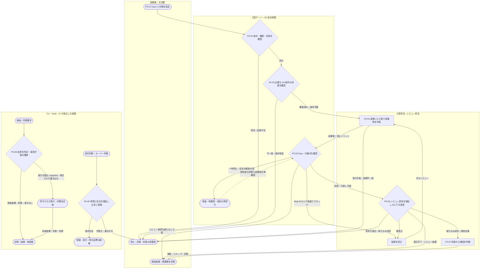
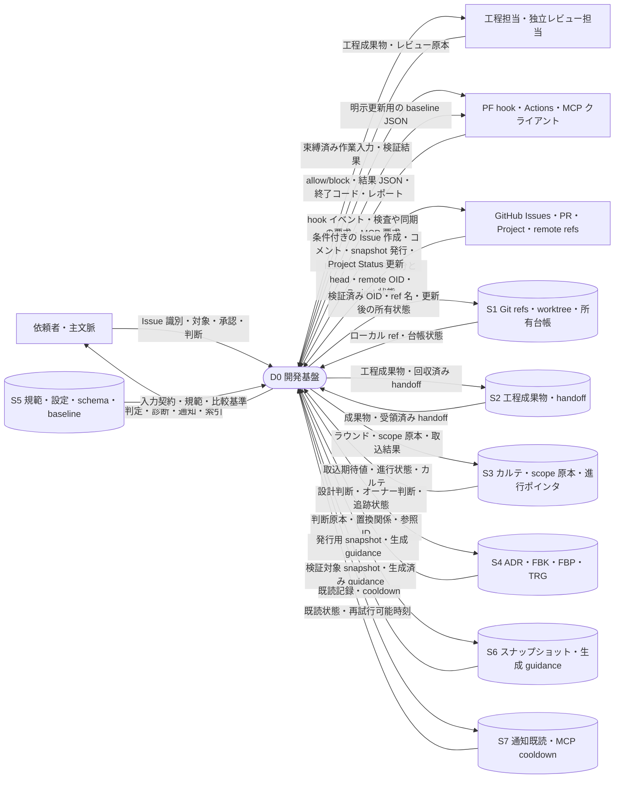

# 開発基盤の Level 0 PFD・DFD

基準は `main` [`4866a525c5ce923992a62cab3b6458d31bbda9dc`](https://github.com/hiratashinnya/review-system/commit/4866a525c5ce923992a62cab3b6458d31bbda9dc)。識別子と担当は [発掘目録](README.md) に従う。この図では工程で交わる境界と独立した検査・記録経路を示す。実行者や前提は各入口によって異なる。製品側の既存 DFD は [docs/process/01-dfd-level1.md](../../process/01-dfd-level1.md) を参照。

## PFD — P0 開発作業・補助処理

| 処理・担当 | 正常経路と外部副作用 | 拒否・保留・診断の境界と根拠 |
| --- | --- | --- |
| `P0-01`〜`P0-02` D2、依存判定 D5 | 依頼から GitHub の証拠または検証対象の snapshot、工程承認・束縛を照合。許可後の managed dispatch は起動単位の所有台帳を更新し得る。 | 依存や証拠の不備、承認と role/run/target/OID/digest の不一致を診断。条件を満たさない起動へ進まない。[工程ゲート](../../../issue_start/gate.py) · [束縛](../../../issue_start/phase_dispatch.py) · [束縛テスト](../../../tests/unit/test_phase_dispatch_binding.py) |
| `P0-03` D3 | 対象操作に応じて GitHub/Git の起点・OID を確認。安全な分岐では ref、worktree などのローカル Git 状態が変わる。検証のみの呼出では結果だけを返す。 | repo、ref、対象 OID が不整合なら拒否。[起点 facade](../../../branch_source/policy.py) · [adopt facade](../../../gitgate/adopt.py) · [起点テスト](../../../tests/unit/test_branch_source_refactor_g05.py) |
| `P0-04`〜`P0-05` D2、回収・解放 D3 | IR/VD/CP/TestDesign 等の成果物と handoff を生成。必要時に handoff を回収し、台帳と worktree の解放状態を更新する。 | `issue-fixer` の Stop でカルテ判定がブロックを返す場合は解放へ進まない。handoff 未検出は入れ子委譲待ちと区別できず保留する経路があり、回収失敗は stale の診断を残す経路、解放だけ残る場合は `release_pending` がある。図の再試行は条件を再評価する後続の処理。[工程成果物の書込](../../../issue_envelope/store.py) · [停止制御](../../../issue_start/subagent_hooks.py) · [停止テスト](../../../tests/unit/test_subagent_hooks.py) · [回収テスト](../../../tests/unit/test_gitgate_worktree_g02.py) |
| `P0-06`〜`P0-07` D1 | レビュー原本を期待値に照合し、カルテと scope 原本を更新。通知フックは対象 verb の status を読み、既読記録に応じて `systemMessage` を返す。GitHub へ指摘を post する場合は専用 verb。 | round・原本不適合は取込拒否。通知用 status を取れない場合はスキップ、通知の既読記録に失敗しても通知は返し得る。[取込](../../../karte/reviewer_cli.py) · [取込テスト](../../../tests/unit/test_karte_reviewer_ingest.py) · [通知](../../../karte_notify/hook.py) · [通知テスト](../../../tests/unit/test_karte_notify_fail_open.py) |
| `P0-08` D5 | 検査を単独実行できる。blocker の snapshot は Actions が発行する。展開対象の生成は `guidance_sync render`、Project Status は許可された経路の apply が行う。 | blocker の部分 snapshot は診断データとして発行でき、Actions は発行後に異常を報告する。Project は snapshot 不正時に API の前で中断、差分なし・非適用は正常扱いの経路を持つ。parity の `STALE` は診断。[発行 workflow](../../../.github/workflows/blocker-snapshot.yml) · [Project CLI](../../../project_status_sync/cli.py) · [Project テスト](../../../tests/unit/test_project_status_sync.py) · [parity 仕様](../../../asset_parity/README.md) |
| `P0-09` D4 | 判断を既存 CLI で記録し、索引を導出する。ADR の明示的な `file-issue --create` では外部 Issue 作成を伴う。 | 検査が schema 不正や既存原本の不適切な変更を報告する。Issue 作成後に追跡番号の書戻しが失敗した場合は番号から復旧。[ADR の使い方](../../../adr/README.md) · [ADR テスト](../../../tests/unit/test_adr.py) · [台帳の検査](../../../feedback_ledger/check.py) · [台帳テスト](../../../tests/unit/test_feedback_ledger.py) |

## DFD — D0 開発基盤のデータ境界

| ストア | 原本・生成物、更新主体 | 根拠 |
| --- | --- | --- |
| `S1` D2/D3 | Git がローカル ref と worktree を保持。`tmp/_worktree/ledger.json` は main worktree にある所有情報の原本で、`issue_start` の台帳 API を工程ゲート、フック、`gitgate` が使う。remote 側の証拠は GitHub/Git の照会結果として別に扱う。 | [所有台帳](../../../issue_start/worktree_ledger.py) · [台帳呼び出し](../../../gitgate/worktree_ledger_access.py) · [台帳テスト](../../../tests/unit/test_worktree_ledger.py) |
| `S2` D2/D3 | 工程担当が種類ごとのディレクトリに canonical TOML を作成。`tmp/_handoff/` 等の提出物は検証されて受け渡される。束縛用の dispatcher の承認、期待値、Git OID と、成果物側の申告を照合する。 | [配置規則](../../../issue_envelope/placement.py) · [工程 handoff](../../../issue_envelope/handoff.py) · [回収](../../../gitgate/worktree_collect_handoff.py) · [配置テスト](../../../tests/issue_envelope_tests/test_artifact_paths.py) |
| `S3` D1 | `tmp/_karte/issue-<N>.md` は指摘の継続・解消を保持。`active.json` は進行先と取込期待値、scope 原本と来歴は専用データ。`karte` の書込経路が更新し、`status` の表示は導出。 | [カルテの保存境界](../../../karte/README.md) · [来歴](../../../karte/scope_origin_store.py) · [来歴テスト](../../../tests/unit/test_karte_scope_origin.py) |
| `S4` D4 | `<tool>/adr/*.toml` は道具別設計判断の追跡原本。`.ai/feedback/{ledger,queue,triage}/*.toml` はオーナー判断・改訂案・棚卸しの記録。各 CLI が保存し、索引と表示はそこから導出。 | [ADR schema](../../../adr/schema.py) · [台帳パス](../../../feedback_ledger/paths_layout.py) · [ADR README](../../../adr/README.md) · [台帳 README](../../../feedback_ledger/README.md) |
| `S5` D5 | 版管理された規範・schema・例外・`maintainability_lint/baseline.json` が判定入力。lint の baseline は明示生成できる負債集合。`.ai/guidance/` と共通原則 Skill の原稿は guidance の入力正本。 | [baseline の読み書き](../../../maintainability_lint/baseline.py) · [guidance の入力・出力パス](../../../guidance_sync/sources.py) · [guidance テスト](../../../tests/unit/test_guidance_sync.py) |
| `S6` D5 | GitHub Issue 依存を元に `blocker_gate` が snapshot JSON を生成し、Actions が `blocker-snapshot` ブランチへ発行。gate と Project 同期は completeness・鮮度等を用途別に検証する。`AGENTS.md` と `.github/copilot-instructions.md` は `guidance_sync` が原稿から導出する展開先。 | [snapshot](../../../blocker_gate/snapshot.py) · [発行先](../../../.github/workflows/blocker-snapshot.yml) · [鮮度の検証](../../../project_status_sync/snapshot_check.py) · [同期処理](../../../guidance_sync/sync.py) |
| `S7` D1/D2 | 通知フックが `tmp/_karte/notified/issue-<N>.json` に既読状態を保持。レビュー MCP は `${XDG_STATE_HOME:-~/.local/state}/claude-review-mcp/rate-limit.json` に自身の cooldown を保持。カルテ原本への更新と、レビュー原本の受入はそれぞれ `karte` が担当する。 | [通知状態](../../../karte_notify/notify.py) · [MCP の保存と参照](../../../.codex/mcp/claude_review/server.py) · [MCP テスト](../../../tests/unit/test_claude_review_mcp.py) |

Level 1 の引き渡しは D1 が `P0-06`・`P0-07`／`S3`・`S7` の通知側、D2 が `P0-01`・`P0-02`・`P0-04`・`P0-05`／`S1`・`S2`・`S7` の MCP 側、D3 が `P0-03`・`P0-05`／`S1`・`S2` の Git 側、D4 が `P0-09`／`S4`、D5 が `P0-02` の依存判定と `P0-08`／`S5`・`S6`。共有境界では変更主体と読取側を双方の図で照合する。[後続の図・根拠の規則](README.md#f1-に渡す図根拠の規則)
