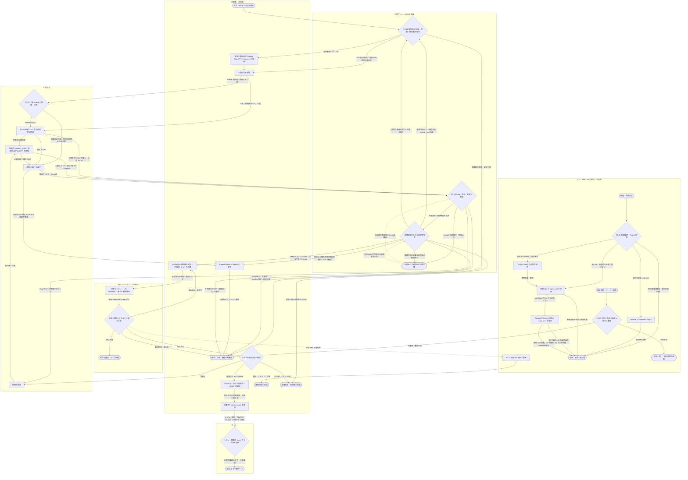
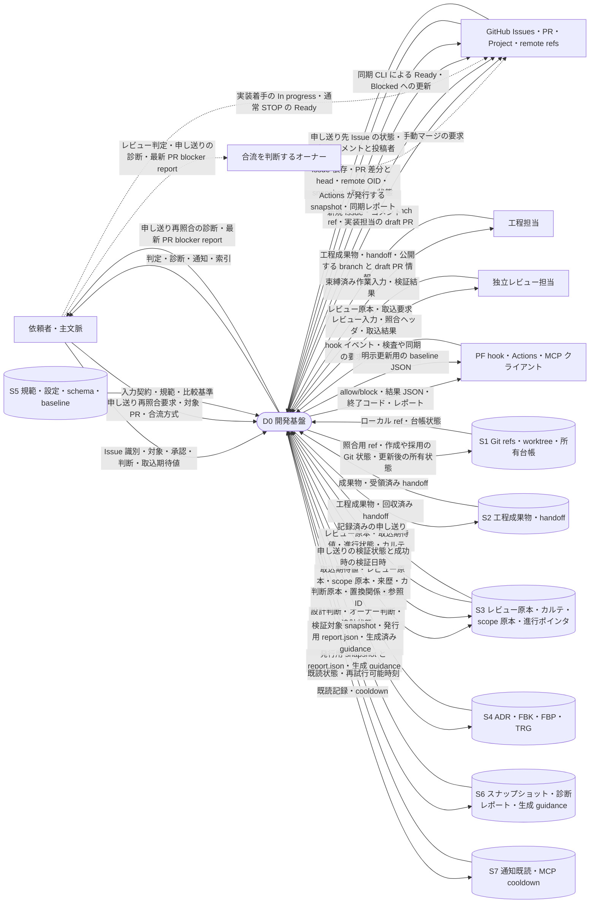

# 開発基盤の Level 0 PFD・DFD

基準は `main` [`4866a525c5ce923992a62cab3b6458d31bbda9dc`](https://github.com/hiratashinnya/review-system/commit/4866a525c5ce923992a62cab3b6458d31bbda9dc)。識別子と担当は [発掘目録](README.md) に従う。この図では工程で交わる境界と独立した検査・記録経路を示す。実行者や前提は各入口によって異なる。製品側の既存 DFD は [docs/process/01-dfd-level1.md](../../process/01-dfd-level1.md) を参照。

## PFD — P0 開発作業・補助処理

| 処理・担当 | 正常経路と外部副作用 | 拒否・保留・診断の境界と根拠 |
| --- | --- | --- |
| `P0-01`〜`P0-02` D2、依存判定 D5 | 依頼から GitHub の証拠または検証対象の snapshot、工程承認・束縛を照合。後続作者の起動前に、検査作業面の detached HEAD と対象 branch を保持する worktree の有無を確認する。managed dispatch が許可されると、起動単位で所有台帳の起票を試みる。 | 依存や証拠の不備、承認や作業面の不一致は起動前に拒否し、拒否された作者の台帳 entry は起票されない。[工程ゲート](../../../issue_start/gate.py) · [作業面の照合](../../../issue_start/phase_target_binding.py) · [束縛テスト](../../../tests/unit/test_phase_dispatch_binding.py) |
| `P0-02`・`P0-05` の Project Status 更新 D2 | 工程契約では、実装前の Issue-start が `ALLOW` を返した直後かつ実装担当の起動前に、主文脈が `In progress` に更新する。実装担当から通常の STOP を受けたら `Ready` に戻してからオーナーへ報告する。 | `BLOCK` では着手時更新を行わない。Codex 実行者の上限で引継ぎが成立し切替再投入する場合は Status を維持する。引継ぎが成立しなければ通常の STOP を扱う。Claude 担当自身の上限は回収・解放と継続検査の条件を満たす場合だけ再投入し、`running` の残留はオーナーへ報告する。[工程契約](https://github.com/hiratashinnya/review-system/blob/4866a525c5ce923992a62cab3b6458d31bbda9dc/.ai/skills/issue-pipeline/SKILL.md#L222-L229) · [上限時の扱い](https://github.com/hiratashinnya/review-system/blob/4866a525c5ce923992a62cab3b6458d31bbda9dc/.ai/skills/issue-pipeline/SKILL.md#L186-L201) |
| `P0-03` D3 | 起動した作者が、担当の worktree で初回設計の `new-branch` または後続の `adopt-branch` を行う。`verify_branch_source` は default または PR head を照合用ローカル ref に fetch し、`new-branch` は照合済み OID で作成・checkout する。`adopt-branch` は既存 branch の ref・OID・使用状況を照合して checkout する。 | 作成・checkout 前の拒否でも、fetch 済みの照合用 ref の更新は残り得る。起動済みの後続作者の採用失敗は通常 STOP となり、作者の entry が台帳に残る。実装担当の STOP が届いたら主文脈が `Ready` に戻して報告する。[作者の契約](../../../.ai/agents/creation-stage-contract.md) · [起動前拒否・起動後の採用失敗](https://github.com/hiratashinnya/review-system/blob/4866a525c5ce923992a62cab3b6458d31bbda9dc/.ai/troubleshooting/issue-pipeline.md#L43-L57) · [起点 facade](../../../branch_source/policy.py) · [CLI](../../../gitgate/cli.py) · [起点テスト](../../../tests/unit/test_branch_source_refactor_g05.py) · [採用テスト](../../../tests/unit/test_gitgate_refactor_g04.py) |
| `P0-04` D2、Git 操作 D3 | 工程担当が IR/VD/CP/TestDesign 等の成果物と handoff を作成。branch を継承する作者は commit・push し、後続作者は回収・解放済み receipt とリモート branch の exact OID を照合する。実装担当は検証・commit・push の後に draft PR を開き、その head が実装レビューの照合対象になる。 | push や draft PR の作成に失敗した場合は、存在を確認できた ref・PR と停止理由を主文脈へ渡す。後続の採用は承認された OID と所有状態が前提。[工程契約](../../../.ai/skills/issue-pipeline/SKILL.md) · [実装担当](../../../.ai/agents/issue-implementer.md) · [push テスト](../../../tests/unit/test_gitgate.py) · [後続の adopt テスト](../../../tests/unit/test_gitgate_worktree.py) |
| `P0-05` D2、回収・解放 D3 | Stop フックが担当本人の handoff を検出すると台帳を `stopped` に進め、回収・解放を試みる。STOP の報告も回収対象になる。後続工程は束縛に合う `ready` かつ未解消の指摘・未決の判断がない入力を受理し、後続作者の起動は前担当の `released` と回収済み receipt を検証する。 | 手掛かりとなる handoff がない場合は `running` のまま保留する。担当が続行できる一時停止なら後の Stop で回収できるが、実行が終了したままなら回収・後続 dispatch が拒否される。回収失敗は `stale`、回収後の物理削除待ち `release_pending` は次の gate が再試行。fixer の Stop がカルテ検査でブロックされた場合は回収・解放段に進まない。同じ role の再投入は検証済みの実行上限 STOP receipt を扱う別の継続経路。[Stop](../../../issue_start/subagent_hooks.py) · [工程入力](../../../issue_envelope/handoff.py) · [作者の継続](../../../issue_start/author_continuation.py) · [解放待ち](../../../issue_start/gate_residue.py) · [停止・回収テスト](../../../tests/unit/test_subagent_hooks.py) · [running 残留テスト](../../../tests/unit/test_claude_limit_running_stall.py) |
| `P0-06` D1、レビュー依頼は主文脈 | 主文脈は `karte activate` で取込期待値を記録してから独立レビューを依頼。現行の Claude Code の `pr-reviewer` は、主 checkout にある `tmp/_handoff/pr-reviewer--<key>.md` の絶対パスへ原本を新規保存し、本人が `ingest-reviewer` で取り込む。CLI が専用パス・ヘッダ・round を検証し、scope 申告原本、カルテ、来歴の確定、進行ポインタの順に保存する。 | 期待値不一致・空レポート（[#801](https://github.com/hiratashinnya/review-system/issues/801)）はカルテ等の書込前に拒否。保存途中のエラーと、要再掲の指摘を引き継いだ「取込済み・未完了」は下表の回復へ。取込完了後の是正・完了は主文脈がカルテから判断する。[レビュー担当](../../../.ai/agents/pr-reviewer.md) · [受入 CLI](../../../karte/reviewer_cli.py) · [保存処理](../../../karte/ingest_review.py) · [受入・回復テスト](../../../tests/unit/test_karte_reviewer_ingest.py) |
| `P0-07` D1 | 通知フックは対象 verb の後に `status` を読み、既読記録に応じて `systemMessage` を返す。GitHub への指摘の発行は専用 verb。 | 通知用 status を取得できない場合はスキップ。既読記録の保存に失敗しても通知は返し得る。[通知](../../../karte_notify/hook.py) · [通知テスト](../../../tests/unit/test_karte_notify_fail_open.py) |
| `P0-08` D5 | 検査は単独実行できる。Actions が blocker snapshot を発行。Project 同期 CLI は有効な snapshot と Project の状態から計画を作り、apply で設定する値は `Ready` / `Blocked` に限る。`In progress` / `In review` は維持する。workflow は CLI がローカルに保存した `report.json` を、終了コード 0 または 20 のとき `project-status-sync-report` ブランチへ発行する。 | dry-run は Status を更新せず、不正・不完全・期限切れ snapshot は Project API の前で中断する。いずれもレポートの発行対象になり得る。発行成功後に CLI 20 を報告して job を失敗させる。push 拒否などで発行 step が失敗すると job はその場で失敗する。その回のレポートの発行は確認できず、CLI 20 の報告 step も実行されない。発行 step のログと CLI の Step Summary で診断する。保存不能など CLI のその他の非 0 は発行前に job が失敗する。blocker の部分 snapshot は発行後に異常を報告でき、parity の `STALE` は診断。[snapshot workflow](../../../.github/workflows/blocker-snapshot.yml) · [Project workflow](../../../.github/workflows/project-status-sync.yml) · [同期テスト](../../../tests/unit/test_project_status_sync.py) · [parity 仕様](../../../asset_parity/README.md) |
| `P0-09` D4 | 判断を既存 CLI で記録し、索引を導出する。ADR の明示的な `file-issue --create` では外部 Issue 作成を伴う。 | 検査が schema 不正や既存原本の不適切な変更を報告する。Issue 作成後に追跡番号の書戻しが失敗した場合は番号から復旧。[ADR の使い方](../../../adr/README.md) · [ADR テスト](../../../tests/unit/test_adr.py) · [台帳の検査](../../../feedback_ledger/check.py) · [台帳テスト](../../../tests/unit/test_feedback_ledger.py) |
| `P0-10` 申し送り再照合 D1、実行・提示 D2 | 合流前に主文脈が `karte handoff-recheck` を呼ぶ。カルテの既存申し送りと現在の宛先・内容を照合し、GitHub から取得した宛先 Issue が open であることと、転記コメントの URL・内容と、認証中のユーザーが投稿者であることを検証する。整合すれば、`karte` がカルテの申し送りに `verified` と検証日時を保存する。 | 取得失敗、宛先のクローズ、コメントの編集・削除や不一致では、対象の記録に `invalid` を保存して理由を返す（終了コード 4）。観測後に finding が変わった場合は書込を拒否する。保存エラーでも 4 を返し、古い検証状態が残り得る。主文脈は無効・不一致・保存失敗を合流前の診断に添える。[再照合](../../../karte/verb_handoff_recheck.py) · [読み戻し](../../../karte/finding_handoff_observe.py) · [書戻し](../../../karte/finding_handoff_store.py) · [再照合テスト](../../../tests/unit/test_karte_finding_handoff_verbs_recheck.py) |
| `P0-10` PR blocker report D5、実行・提示 D2 | 実装レビューが clean になったら、主文脈は `pr_merge_gate report` で PR・合流方式に対する最新の依存証拠を取る。`ALLOW` 候補は GitHub の証拠を再取得して安定性を照合する。主文脈はレビュー判定、申し送りの診断、report をオーナーへ提示して停止し、オーナーが GitHub で手動の合流を判断する。 | ブロッカーは `BLOCK`、再評価で証拠が安定しない場合や取得不能などは `ERROR` として報告する。`ALLOW` は取得時点の判断材料で、report の `automatic_merge_authorized` と `merge_api_called` は常に `false`。手動操作との間に証拠が変わり得る。[工程契約](https://github.com/hiratashinnya/review-system/blob/4866a525c5ce923992a62cab3b6458d31bbda9dc/.ai/skills/issue-pipeline/SKILL.md#L280-L285) · [report の契約](../../tools/pr-merge-gate.md) · [再評価](../../../pr_merge_gate/gate.py) · [判定テスト](../../../tests/unit/test_pr_merge_gate.py) |

`P0-06` の保存到達点と回復は [カルテの取込契約](../../../karte/README.md) に従う。

| 取込結果 | 保存到達点と次の担当 |
| --- | --- |
| 検証拒否（4） | カルテ・scope 申告原本・ポインタは更新前。主文脈とレビュー担当が期待値や原本の不適合を確認する。 |
| scope 保存後、カルテ書込失敗（4） | カルテより先に保存された scope 申告原本と来歴の処理中記録が残り得る。カルテの round と期待値は据え置き。原因を解消してからレビュー担当が同じ原本で再取込する。 |
| カルテ保存後、来歴確定失敗（4） | カルテには当該 round がある。主文脈が `render` で保存済み round を確認し、`activate` でポインタを回復する。当該取込の出所は回復後も未証明で、来歴の読取側は未確定の申告を証拠に使わない。 |
| 来歴確定後、ポインタ書込失敗（4） | カルテと来歴は確定済みで、ポインタは進んでいない。主文脈が `render` で保存済み round を確認し、`activate` でポインタを回復する。 |
| 取込済み・未完了（5） | 再掲漏れの対象指摘を引き継いで round を保存し、期待値を消費済み。主文脈が次 round の期待値を記録し、レビュー担当が再掲する。 |
| 取込完了（0） | 主文脈がカルテを読み、是正・完了を判定する。 |

## DFD — D0 開発基盤のデータ境界

破線は主文脈が工程契約に沿って行う連絡・更新と、判断後にオーナーが GitHub で行う操作を示す。

| ストア | 原本・生成物、更新主体 | 根拠 |
| --- | --- | --- |
| `S1` D2/D3 | Git がローカル ref と worktree を保持。起点の検証が照合用 ref を更新し、作成・採用が branch の checkout を変える。`tmp/_worktree/ledger.json` は main worktree にある所有情報の原本で、工程ゲート、フック、`gitgate` が `issue_start` の台帳 API を使って更新する。作者の push 済み remote ref と draft PR の head は GitHub/Git から照会する。 | [起点検証](../../../branch_source/policy.py) · [所有台帳](../../../issue_start/worktree_ledger.py) · [台帳テスト](../../../tests/unit/test_worktree_ledger.py) |
| `S2` D2/D3 | 工程担当が所定のディレクトリに canonical TOML と工程 handoff を作成し、回収処理が回収物を主 checkout に保存する。dispatcher の承認・期待値・Git OID を成果物の申告と照合する。 | [配置規則](../../../issue_envelope/placement.py) · [工程 handoff](../../../issue_envelope/handoff.py) · [回収](../../../gitgate/worktree_collect_handoff.py) · [配置テスト](../../../tests/issue_envelope_tests/test_artifact_paths.py) |
| `S3` D1 | 主文脈が `activate` で取込期待値を `tmp/_karte/active.json` に記録する。独立レビュー担当は主 checkout の `tmp/_handoff/pr-reviewer--<key>.md` にレビュー原本を直接保存する。`karte` の取込処理が scope 申告原本・来歴、`tmp/_karte/issue-<N>.md`、進行ポインタを更新し、`status` の表示は導出する。`handoff-recheck` は同じカルテの申し送り記録を読み、観測後の変更がないことを確かめて検証状態を書き戻す。検証日時を更新するのは `verified` を保存するとき。 | [レビュー原本パス](../../../karte/handoff_path.py) · [カルテの保存境界](../../../karte/README.md) · [来歴](../../../karte/scope_origin_store.py) · [来歴テスト](../../../tests/unit/test_karte_scope_origin.py) · [申し送りの書戻し](../../../karte/finding_handoff_store.py) |
| `S4` D4 | `<tool>/adr/*.toml` は道具別設計判断の追跡原本。`.ai/feedback/{ledger,queue,triage}/*.toml` はオーナー判断・改訂案・棚卸しの記録。各 CLI が保存し、索引と表示はそこから導出。 | [ADR schema](../../../adr/schema.py) · [台帳パス](../../../feedback_ledger/paths_layout.py) · [ADR README](../../../adr/README.md) · [台帳 README](../../../feedback_ledger/README.md) |
| `S5` D5 | 版管理された規範・schema・例外・`maintainability_lint/baseline.json` が判定入力。lint の baseline は明示生成できる負債集合。`.ai/guidance/` と共通原則 Skill の原稿は guidance の入力正本。 | [baseline の読み書き](../../../maintainability_lint/baseline.py) · [guidance の入力・出力パス](../../../guidance_sync/sources.py) · [guidance テスト](../../../tests/unit/test_guidance_sync.py) |
| `S6` D5 | `blocker_gate` が Issue 依存から snapshot JSON を生成し、Actions が `blocker-snapshot` ブランチへ発行する。gate と Project 同期は完全性や鮮度を用途別に検証する。Project 同期 CLI はローカルに `report.json` を保存し、Actions が `project-status-sync-report` ブランチへ発行する。`AGENTS.md` と `.github/copilot-instructions.md` は `guidance_sync` が原稿から導出する展開先。 | [snapshot 発行](../../../.github/workflows/blocker-snapshot.yml) · [鮮度の検証](../../../project_status_sync/snapshot_check.py) · [レポート発行](../../../.github/workflows/project-status-sync.yml) · [guidance 同期](../../../guidance_sync/sync.py) |
| `S7` D1/D2 | 通知フックが `tmp/_karte/notified/issue-<N>.json` に既読状態を保持。レビュー MCP は `${XDG_STATE_HOME:-~/.local/state}/claude-review-mcp/rate-limit.json` に自身の cooldown を保持。カルテ原本への更新と、レビュー原本の受入はそれぞれ `karte` が担当する。 | [通知状態](../../../karte_notify/notify.py) · [MCP の保存と参照](../../../.codex/mcp/claude_review/server.py) · [MCP テスト](../../../tests/unit/test_claude_review_mcp.py) |

Level 1 の引き渡しは D1 が `P0-06`・`P0-07`／`S3`・`S7` の通知側、D2 が `P0-01`・`P0-02`・`P0-04`・`P0-05`／`S1`・`S2`・`S7` の MCP 側、D3 が `P0-03`・`P0-05`／`S1`・`S2` の Git 側、D4 が `P0-09`／`S4`、D5 が `P0-02` の依存判定と `P0-08`／`S5`・`S6`。`P0-10` の合流前の工程と提示は D2、申し送りの再照合は D1、PR blocker report の再評価・出力は D5 が発掘する。共有境界では変更主体と読取側を双方の図で照合する。[後続の図・根拠の規則](README.md#f1-に渡す図根拠の規則)
